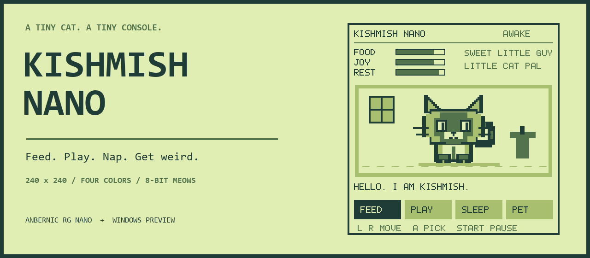
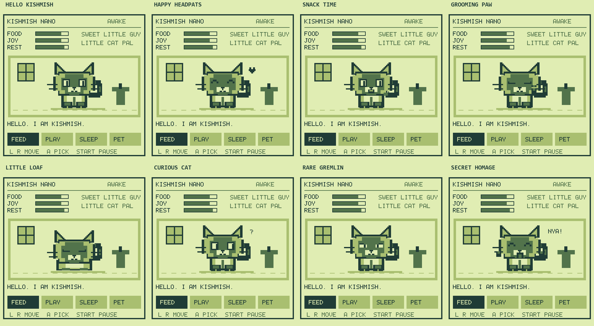
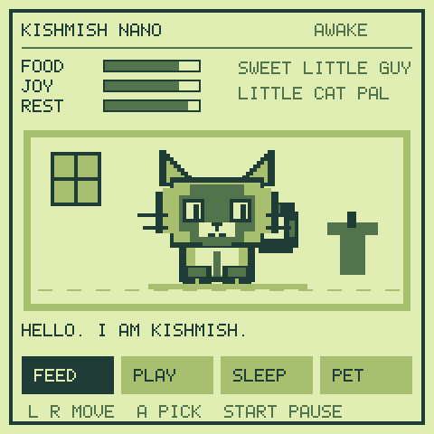
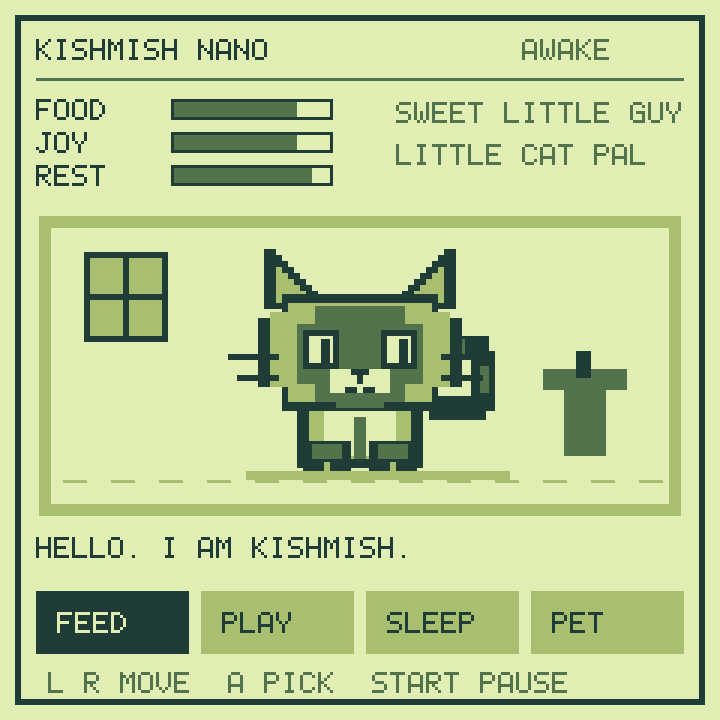
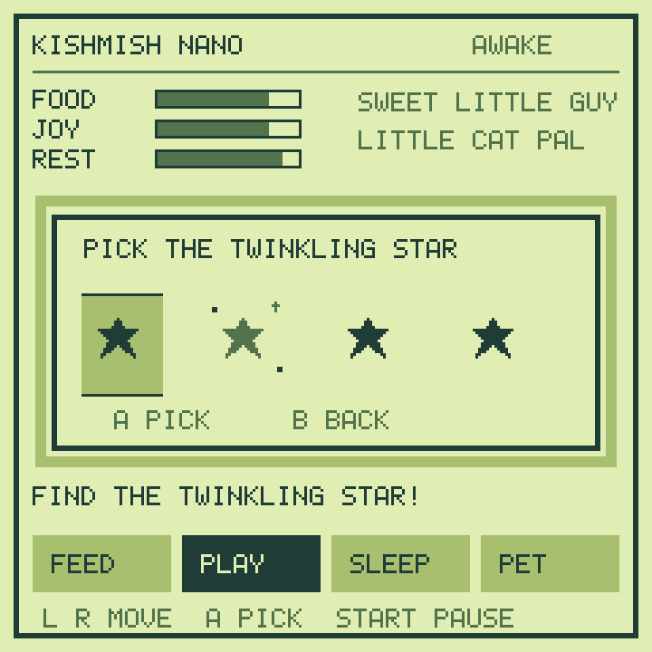
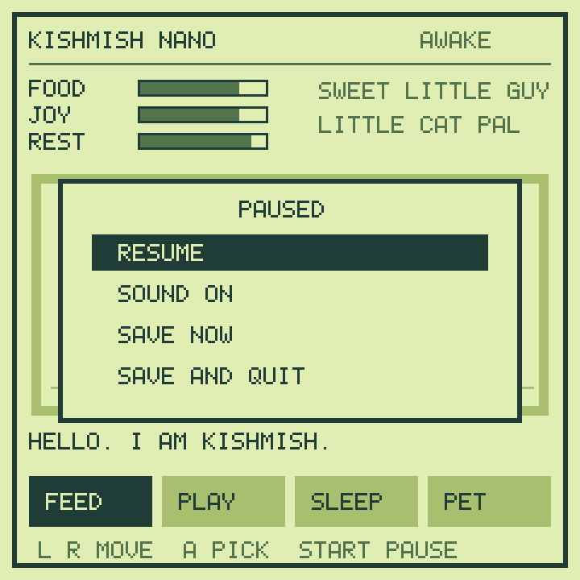
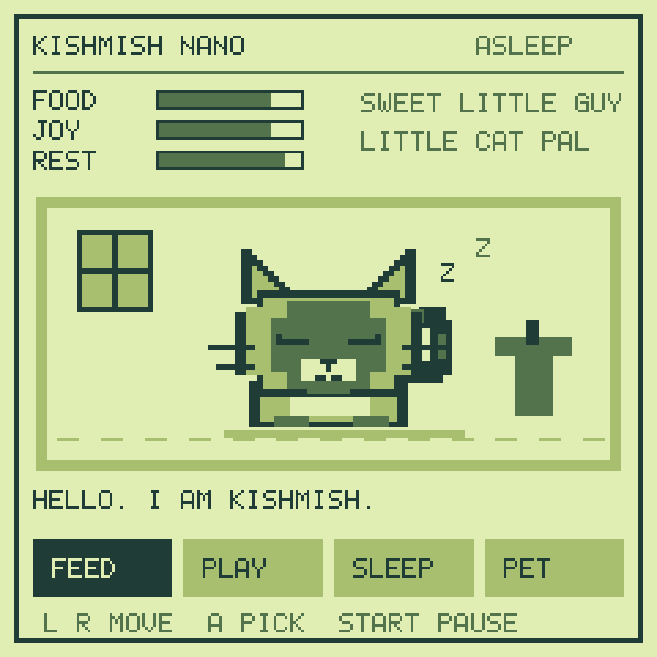

<p align="center">
  
</p>

<p align="center">
  <a href="https://github.com/Alialhashemi23/kishmish-nano/actions/workflows/test.yml"></a>
  
  
  <a href="LICENSE"></a>
</p>

# Kishmish Nano

**A tiny Siamese cat with increasingly concerning thoughts.**

Kishmish Nano is a Tamagotchi-inspired virtual pet made for the **Anbernic RG Nano**. Feed him, find his twinkling star, let him nap, and give him affection. Keep him happy and he's your sweet little guy. Neglect him and his dialogue starts getting weird.

Four Game Boy-inspired colors. A 240×240 room. Code-drawn pixel art. Little 8-bit meows.

<p align="center">
  
</p>

<p align="center"><a href="https://github.com/Alialhashemi23/kishmish-nano/releases/tag/v0.2.0-rc.1"><strong>Download the phase-two playtest →</strong></a></p>

## Meet Kishmish

- **Feed:** restore food with a snack and a meow.
- **Play:** spot the star that twinkles. The picker has its own selection, separate from the care menu.
- **Sleep:** let him recover energy. Tap again to wake him.
- **Pet:** give him affection and calm his chaos.
- **Pause:** stop the simulation, mute sounds, save manually, or save and return to GMenu2X.

Kishmish has a dark Siamese face mask, pointed ears, whiskers, little paws, and a curled tail. Every pixel of the game is drawn by C code; no image assets or font files are loaded for the room or character. The launcher icon and synthesized WAV clips are separate generated assets.

## Phase two: a little more cat

Kishmish now blinks, twitches an ear, flicks his tail, grooms a paw, and settles into a little loaf. These brief idle behaviors appear roughly every 12–24 seconds while awake. Rare curious and gremlin faces add surprises, with chaos influencing the rare expression. Feeding brings a tiny munch; petting brings a happy squint and heart. No animation locks input or adds chores.

Occasional thoughts use needs, energy, and chaos. Neko-speak is sprinkled in rather than used for every line, and thoughts wait before replacing a care reaction. Consistent affection also shapes return greetings. Familiarity is saved quietly—there is no new meter to maintain.



<p align="center"></p>

*This montage showcases renderer poses in sequence; it does not represent how frequently random events happen during play.*

<details>
<summary>Secret interaction — reveal the input</summary>

On the awake care screen, enter **Left, Right, Left, Right, B, A**. Keep each gap under four seconds. Kishmish performs a goofy reaction and an original synthesized **“bu-re-nyuuu”** vocal homage. No Neco-Arc recording or voice model is included.

The final A does not feed or select anything. The sequence is inactive while asleep, paused, or in the star game. A twenty-second cooldown keeps repeated playback from getting noisy; repeating the complete code during cooldown still won't trigger a care action. Sound respects the pause-menu mute setting.

</details>

## Screenshots

| Care for your cat | Find the twinkling star |
| :---: | :---: |
|  |  |
| **Pause, save, or quit** | **Let him nap** |
|  |  |

*These are captures of the actual software framebuffer, scaled with nearest-neighbor pixels. They are not photographs of the handheld. The GIF is generated from the same renderer.*

## Play on the RG Nano

1. Download **`kishmish-nano.opk`** from the [phase-two playtest](https://github.com/Alialhashemi23/kishmish-nano/releases/tag/v0.2.0-rc.1).
2. Turn on the Nano and connect a data-capable USB cable.
3. Select **Mount USB** on the Nano and confirm. Leave the microSD card in the device.
4. Copy the OPK into the card's **`Applications`** folder.
5. Safely eject the drive in your computer, then select **Eject USB** on the Nano and confirm.
6. Open **GMenu2X → Games → Kishmish Nano**. A reboot normally isn't required.

The OPK includes both `anbernic` and `funkey-s` launcher metadata. Stock Nano requires the `anbernic` entry. It also includes a private musl/SDL runtime so it can run alongside the stock firmware's different C runtime without replacing system files.

### Controls

| Action | RG Nano | Windows preview |
| :--- | :--- | :--- |
| Choose an option | D-pad left/right; up/down also work | Arrow keys |
| Confirm | A | Z, Enter, or Space |
| Back out of the star game / resume from pause | B | X or Backspace |
| Open/close pause | **Start** | P or Escape |
| Save and return to the launcher | Start → Save and Quit → A | Pause → Save and Quit |

**Use Start to pause.** The hardware power button is handled by the system. Full device suspend/resume is not implemented, and returning to the clock is not the same as opening the game's pause menu. Save and quit before putting the device away.

## Play on Windows

Download and extract **`kishmish-nano-windows.zip`** from the [phase-two playtest](https://github.com/Alialhashemi23/kishmish-nano/releases/tag/v0.2.0-rc.1), then run **`Kishmish-Windows.exe`**. Keep the `sounds` folder next to the executable. No SDK is needed to play.

## Saves and the clock

| Platform | Save location |
| :--- | :--- |
| Stock RG Nano | `/mnt/Anbernic/.kishmish-nano/pet.sav` |
| Other handheld setups | `$HOME/.kishmish-nano/pet.sav` |
| Windows | `kishmish.sav` beside the executable |

The game saves after care actions, every 30 seconds of active play, and through **Save Now** or **Save and Quit**. Saves live outside the OPK, so replacing the package preserves your pet.

While running, needs use elapsed runtime. While closed, they use the difference between the saved timestamp and the **system clock**, capped at eight hours. Backward clock changes count as zero elapsed time. The game does not access the RTC hardware directly; set the Nano's date/time correctly for meaningful offline progression.

Food and joy decrease during play; sleeping restores energy. Neglect raises chaos, while affection and successful play reduce it. There is no death mechanic in this MVP. Pausing freezes the running simulation. Mute is session-only. Phase two reads existing MVP saves and appends optional affection/visit fields to the same text format. Old readers can still read the original fields, but saving with an older version discards the new memory fields.

## Build from source

### Windows

Install GCC through MinGW-w64/MSYS2 and make sure `gcc` is on your PATH. From PowerShell:

```powershell
./build-windows.ps1
./build/Kishmish-Windows.exe
```

The script also copies the sounds beside the executable.

### RG Nano / FunKey ARM package

Use Linux (or a Linux container/WSL environment), `squashfs-tools`, and the official **FunKey SDK 2.3.0**. Follow the [SDK setup guide](https://doc.funkey-project.com/developer_guide/tutorials/build_system/build_program_using_sdk/), run its relocation script, and source its environment:

```sh
# Adjust these paths to where you unpacked the SDK.
cd /path/to/FunKey-sdk-2.3.0
./relocate-sdk.sh
. ./environment-setup

cd /path/to/kishmish-nano
sh build-funkey.sh
```

Output: **`build/kishmish-nano.opk`**. The build copies the SDK's musl loader/libc and SDL into the package and launches the game through that private loader. See [third-party notices](THIRD_PARTY.md) before redistributing builds.

### Linux desktop development

The SDL backend can also be compiled against host SDL 1.2:

```sh
sudo apt-get install gcc libsdl1.2-dev
mkdir -p build
cp -r package/sounds build/
gcc -std=c99 -Wall -Wextra -Werror src/game.c src/personality.c src/main.c \
  -o build/kishmish-sdl $(sdl-config --cflags --libs)
cd build
./kishmish-sdl
```

This is a development target; the Windows preview is the supported desktop playtest path.

## Tests and media generation

```sh
sh tests/run.sh
```

Or on Windows:

```powershell
./tests/run.ps1
```

Regression checks cover care, save/reload, corrupt saves, offline clock bounds, independent minigame selection, sound events, pause/resume, mute, and refusing to quit after a failed save. Phase-two tests also check secret input context/timeout/cooldown, optional save extensions, affection memory, idle/dialogue frequency, all seven idle poses, and framebuffer palette/menu isolation. Audio tests validate all four WAV clips. CI also runs the SDL input loop with dummy video/audio through secret playback, mute, Start pause, and saved quit. This does not emulate the Nano's display, buttons, or speaker hardware.

To regenerate the icon, meows, banner, screenshots, and GIF, install Python with Pillow and put GCC on your PATH:

```sh
python tools/generate_assets.py
python tools/generate_media.py
```

The media tool uses a dedicated preview save and does not read your real pet save.

## Project layout

```text
src/                     Pet simulation, personality scheduler, framebuffer, backends
package/                 Launcher metadata, icon, WAV clips, runtime launch script
tests/                   Portable regression tests and runners
tools/                   Procedural assets and framebuffer screenshot tools
docs/images/             README screenshots, GIF, banner, and icon
licenses/                Third-party license notices
.github/workflows/       Core tests and SDL compile check
```

## MVP status

Basic launch and play have been confirmed on a **stock RG Nano**. The phase-two playtest passes Windows/Linux tests, memory-safety checks, a dummy-device SDL input/audio smoke test, and ARM build/runtime dependency checks. Phase-two behavior, sound quality, and physical input still need an on-device test. The stable MVP remains available as v0.1.0. Other firmware versions and FunKey hardware haven't been verified.

Known limits: no full system suspend/resume, no growth stages, no death, no persistent mute preference, and no automatic clock correction. If SDL audio cannot open, the game continues silently and writes diagnostics to `$HOME/.kishmish-nano/boot.log`.

If it returns to the launcher on boot, mount USB and inspect that log. Include your firmware, the log, and steps to reproduce in an issue. See [Contributing](CONTRIBUTING.md) and the [changelog](CHANGELOG.md).

## Credits and license

Created for **Alialhashemi23's RG Nano**, with Kishmish as the resident tiny menace.

Original game code, pixel designs, synthesized sounds, and documentation: [MIT](LICENSE). Bundled SDL and musl retain their own licenses; see [THIRD_PARTY.md](THIRD_PARTY.md). Thanks to the [FunKey Project](https://github.com/FunKey-Project/FunKey-OS) for the SDK and handheld software ecosystem.

An independent virtual-pet project, inspired by classic handheld pets and the Game Boy palette. Not affiliated with Bandai, Nintendo, or Anbernic.
